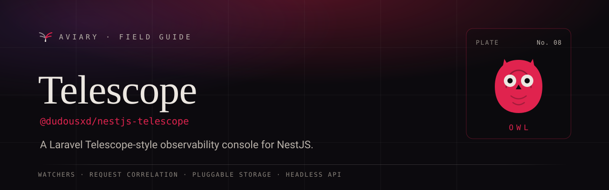
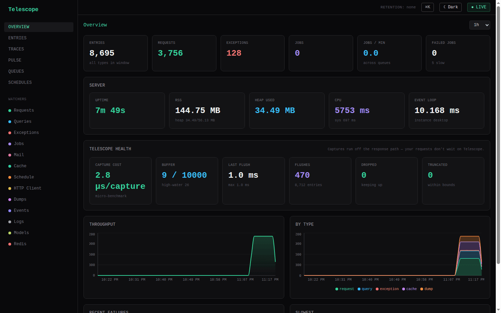
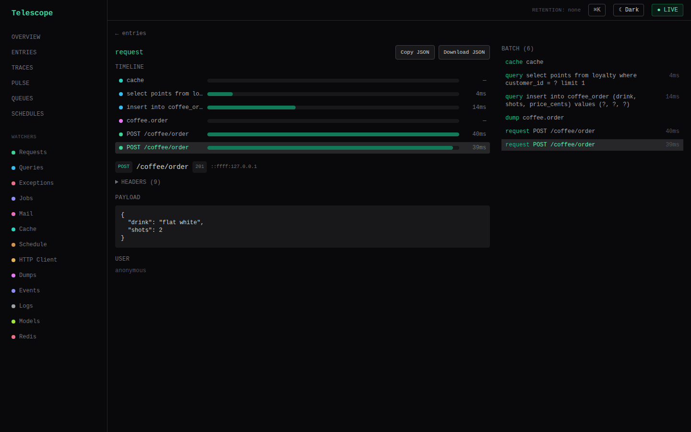

<p align="center">
  <a href="https://davidecarvalho.github.io/aviary/docs/telescope">
    
  </a>
</p>

<p align="center">
  <a href="https://www.npmjs.com/package/@dudousxd/nestjs-telescope"></a>
  <a href="https://github.com/DavideCarvalho/nestjs-telescope/actions/workflows/ci.yml"></a>
  <a href="./LICENSE"></a>
  <a href="https://davidecarvalho.github.io/aviary/docs/telescope"></a>
</p>

<p align="center">
  <b><a href="https://davidecarvalho.github.io/aviary/docs/telescope">📖 Documentation</a></b>
  &nbsp;·&nbsp; part of the <a href="https://davidecarvalho.github.io/aviary/"><b>Aviary</b></a> ecosystem for NestJS 🦉
</p>

> Laravel Telescope, redesigned for NestJS. Watch every request, query, job,
> email, cache hit, and exception — correlated under one batch, off the response
> path, pluggable, and safe in production. Alert new errors to Slack, diagnose
> them with AI, capture frontend errors, and archive before you prune. Express
> **and** Fastify.

`@dudousxd/nestjs-telescope` is an application observability console for NestJS.
A set of watchers capture what happens *inside* a request — every query, queued
job, sent email, cache hit, and thrown exception — correlate it all under one
**batch** via `AsyncLocalStorage`, store it through a pluggable provider, and
expose it through a headless API plus an optional dashboard. It's the missing
Telescope for NestJS, designed framework-idiomatically rather than ported.



## Quick start

**1. Install** core and the dashboard:

```bash
pnpm add @dudousxd/nestjs-telescope @dudousxd/nestjs-telescope-ui
```

**2. Import** two modules. Request and exception capture wire themselves
automatically, and a zero-config SQLite store is on by default:

```ts
import { Module } from '@nestjs/common';
import { TelescopeModule } from '@dudousxd/nestjs-telescope';
import { TelescopeUiModule } from '@dudousxd/nestjs-telescope-ui';

@Module({
  imports: [
    TelescopeModule.forRoot({
      prune: { after: '24h' },
      // In production, protect the routes or the boot fails (see below):
      // decorators: [UseGuards(AuthenticationGuard), Can(ConsolePolicy, 'view')],
    }),
    TelescopeUiModule.forRoot(),
  ],
})
export class AppModule {}
```

Boot, then open **`/telescope`** for the dashboard or hit
`GET /telescope/api/entries/:id` for a request and everything it caused. Most
apps are done in under five minutes — see the
[Getting Started guide](https://davidecarvalho.github.io/nestjs-telescope/docs/getting-started).

## What you get

| Feature | What it does |
|---------|--------------|
| **Watchers** | Request, query, job, mail, cache, schedule, HTTP-client, and exception capture — correlated under one batch in capture order. |
| **Queue console** | A Horizon-style live view of BullMQ and SQS queues: per-state depth, individual jobs, and (with `mutations: true`) retry / remove / promote / redrive. |
| **Pulse** | At-a-glance health: per-type counts, slowest entries, top exceptions, N+1 hotspots, and a throughput sparkline — rolled up from captured entries. |
| **Health & overhead** | Capture runs *off* the response path; the dashboard surfaces Telescope's own host-path µs/capture, buffer pressure, and flush p95 on a `/health` card. |
| **Storage adapters** | A pluggable `StorageProvider` SPI with a self-healing schema: SQLite by default, swap in Redis (multi-instance) or your own. Per-type retention + an `archive.sink` to ship doomed entries to S3 before prune. |
| **Error alerting** | A genuinely *new* exception family pages you — Slack (Block Kit, route/user, deep link), a raw webhook, or a custom sink — plus rate, slow-route, and dropped-entry rules. |
| **AI diagnosis** | `@dudousxd/nestjs-telescope-ai` turns an exception into a probable-cause / suggested-fix report (Bedrock, OpenAI, any AI-SDK model). On-demand button or auto-mode that enriches the Slack alert. |
| **Frontend errors** | An opt-in public endpoint records browser `client_exception` reports through the same pipeline — family hashing, alerts, archive, dashboard. |
| **Request replay** | Re-issue a captured request against the local app from the dashboard (a mutation, so it needs `mutations: true`); replayed calls carry an `x-telescope-replay: 1` header and a `replay` tag. |
| **MCP server** | A stateless JSON-RPC MCP endpoint lets coding agents (Claude Code, Cursor, …) query the captured data directly — list entries, pull a batch waterfall, read the health snapshot, diagnose an exception. |
| **Overload protection** | Watches event-loop lag and auto-pauses capture under pressure, resuming when the loop recovers — a telescope under load can never amplify an incident (on by default). |
| **Protected with NestJS's own tools** | `@nestjs/authentication` + `@nestjs/authorization` via `decorators` or your own controllers; an undecorated console refuses to boot in production (the decorators must actually enforce auth). |

## Dashboard

```ts
import { TelescopeUiModule } from '@dudousxd/nestjs-telescope-ui';
// imports: [TelescopeModule.forRoot(), TelescopeUiModule.forRoot()]
```

A bundled React SPA served by a NestJS module — no frontend dependency imposed
on your app. Open any request to see its **correlated batch**: a waterfall of
the cache reads, queries, jobs, and exceptions it caused, alongside the request
itself.

See [Protecting the routes](#protecting-the-routes) below.



## MCP server

Let a coding agent debug straight from the captured data. With `mcp` enabled,
Telescope serves a stateless JSON-RPC [Model Context Protocol](https://modelcontextprotocol.io)
server (streamable-HTTP) at `<path>/api/mcp`, so an agent can answer
*"why is `POST /checkout` slow?"* by pulling the batch waterfall with every query
it ran — backed by the same storage/stats/diagnosis APIs as the dashboard.

```ts
TelescopeModule.forRoot({
  mcp: true, // omit (or false) and the endpoint answers 404
});
```

Register it with Claude Code:

```bash
claude mcp add --transport http telescope http://localhost:3000/telescope/api/mcp
```

Tools exposed: `list_entries` (filter by type/search/tag/time window),
`get_entry` (one entry + its full batch), `get_batch`, `get_stats` (the last-hour
health snapshot), and `diagnose_exception` (AI diagnosis, when `ai` is
configured). It is protected like every console route, by your `decorators`.

Agent clients send `Authorization: Bearer <key>`, not your session cookie, so
give the MCP route its own decorators with `mcpDecorators` (they replace
`decorators` on that route only) and an `ApiKeyProvider` from
`@nestjs/authentication`:

```ts
TelescopeModule.forRoot({
  mcp: true,
  decorators: [Authenticate({ providers: [SessionCookieProvider] }), Can(ConsolePolicy, 'view')],
  mcpDecorators: [Authenticate({ providers: [TelescopeAgentKey] }), Can(ConsolePolicy, 'view')],
});
```

```bash
claude mcp add --transport http telescope https://app.example.com/telescope/api/mcp \
  --header "Authorization: Bearer $TELESCOPE_MCP_KEY"
```

`TelescopeAgentKey` is your `ApiKeyProvider` subclass (one `findKey` method). The
full recipe, issuing and revoking keys included, is in the
[MCP docs](https://davidecarvalho.github.io/nestjs-telescope/docs/concepts/mcp#recipe-an-api-key-for-the-agent).

## Protecting the routes

Telescope protects its routes only with NestJS's first-party tools,
[`@nestjs/authentication`](https://www.npmjs.com/package/@nestjs/authentication)
and [`@nestjs/authorization`](https://www.npmjs.com/package/@nestjs/authorization).
There are two ways.

**1. Decorators on the mounted controllers.** Keep Telescope's routes and pass
`decorators`. They go on every console controller the module mounts (API, live
stream, MCP; `mcpDecorators` replaces them on MCP alone). Pass the same list to
the UI module, which serves the page:

```ts
const protect = [UseGuards(AuthenticationGuard), Can(ConsolePolicy, 'view')];

TelescopeModule.forRoot({ decorators: protect });
TelescopeUiModule.forRoot({ decorators: protect });
// forRootAsync({ useFactory, decorators: protect }): a static top-level option.
```

**2. Mount the routes yourself.** `routes: false` mounts no controller (capture,
storage, watchers and every service keep running) and the module exports what
the controllers need. Extend the exported controllers and decorate them however
you like:

```ts
@Controller('ops/telescope/api')
@UseGuards(AuthenticationGuard)
@Can(ConsolePolicy, 'view')
class ConsoleApi extends TelescopeController {}

@Controller('ops/telescope')
@UseGuards(AuthenticationGuard)
@Can(ConsolePolicy, 'view')
class ConsolePage extends TelescopeUiController {}

@Module({
  imports: [
    TelescopeModule.forRoot({ path: 'ops/telescope', routes: false }),
    TelescopeUiModule.forRoot({ path: 'ops/telescope', routes: false }),
  ],
  controllers: [ConsoleApi, ConsolePage],
})
export class OpsModule {}
```

`StreamController`, `TelescopeMcpController` and `ClientErrorController` extend
the same way. The base classes carry no guard of their own: your decorators are
the whole gate. Keep `path` set to where you mount them, since the request
capture skips the console's own calls and the page rebases its assets on it.

**The production rule.** With `NODE_ENV === 'production'`, a module that mounts
its routes with no `decorators` (an empty array counts as none) fails the boot
with an error naming both ways (`mcpDecorators: []` too). This applies to `TelescopeModule` and
`TelescopeUiModule`; the otel `GET /metrics` scrape is outside it by default
(Prometheus usually scrapes unauthenticated inside the cluster: keep it
reachable only by the scraper) and joins it with
`forExporter(exporter, { requireProtectionInProduction: true })`. `routes: false` always
boots. Outside production an undecorated console mounts open, so local work
needs no setup. Every mounted controller is also marked open to
`@nestjs/authorization`'s deny-by-default global guard (`Can.Anyone()`), so an
undecorated dev console keeps answering once your app adopts it; a `Can(...)`
in `decorators` is still enforced.

**Public by design: the client-error beacon.** `POST <path>/api/client-errors`
(off until `clientErrors.enabled`) takes reports from any visitor's browser, so
it does not receive `decorators` and does not count toward the production rule.
It keeps its byte cap and per-IP rate limit. To put it behind your own auth,
use `routes: false` and extend `ClientErrorController`.

**Mutations** (queue retry/remove/promote/redrive/enqueue, prune, replay,
profiling) are a feature switched on with `mutations: true` (off: 403). Who may
call them is decided by your decorators like every other route; for a stricter
rule on mutations, mount the routes yourself and override those methods with an
extra `@Can(...)` (class and method requirements both apply; re-declare the
route decorators on the override).

## Links

- **Documentation** — https://davidecarvalho.github.io/nestjs-telescope
- **Example app** — [`examples/basic-app`](./examples/basic-app) boots with zero
  config and fills its own dashboard while you watch.
- **Recipes** — [custom storage](https://davidecarvalho.github.io/nestjs-telescope/docs/recipes/custom-storage),
  [custom watcher](https://davidecarvalho.github.io/nestjs-telescope/docs/recipes/custom-watcher),
  [protecting the routes](https://davidecarvalho.github.io/nestjs-telescope/docs/dashboard/auth),
  [tags & redaction](https://davidecarvalho.github.io/nestjs-telescope/docs/recipes/tags-and-redaction),
  [archiving to S3](https://davidecarvalho.github.io/nestjs-telescope/docs/recipes/archiving-exceptions-to-s3),
  [reporting frontend errors](https://davidecarvalho.github.io/nestjs-telescope/docs/recipes/reporting-frontend-errors),
  [AI exception diagnosis](https://davidecarvalho.github.io/nestjs-telescope/docs/recipes/ai-exception-diagnosis).
- **Architecture** — [`DESIGN.md`](./DESIGN.md) · **Product brief** — [`PRODUCT.md`](./PRODUCT.md)

## Packages

| Package | What it is |
|---------|------------|
| `@dudousxd/nestjs-telescope` | Core: request + exception watchers, recorder, ALS correlation, SQLite store, headless API, pruner |
| `@dudousxd/nestjs-telescope-ui` | Bundled dashboard SPA + composable React components / hooks / client |
| `@dudousxd/nestjs-telescope-mikro-orm` | MikroORM query watcher + N+1 detector |
| `@dudousxd/nestjs-telescope-typeorm` | TypeORM query watcher (host-wired logger) |
| `@dudousxd/nestjs-telescope-prisma` | Prisma query watcher (`$on('query')`) |
| `@dudousxd/nestjs-telescope-bullmq` | BullMQ job watcher: per-job capture + correlation |
| `@dudousxd/nestjs-telescope-mail` | Mail watcher (nodemailer `sendMail`) |
| `@dudousxd/nestjs-telescope-cache` | Cache watcher (get/set hit/miss) |
| `@dudousxd/nestjs-telescope-schedule` | Schedule watcher (`@nestjs/schedule` cron/interval) |
| `@dudousxd/nestjs-telescope-events` | Event watcher (`@nestjs/event-emitter`) |
| `@dudousxd/nestjs-telescope-logs` | Log watcher (Nest `Logger` output) |
| `@dudousxd/nestjs-telescope-redis-watcher` | Redis command watcher (wrapped `ioredis`) |
| `@dudousxd/nestjs-telescope-mikro-orm-watcher` | Model watcher (MikroORM entity lifecycle changes) |
| `@dudousxd/nestjs-telescope-redis` | Redis-backed shared storage (multi-instance) |
| `@dudousxd/nestjs-telescope-parquet` | Tiered storage: a hot store plus a cold Parquet tier on S3 or disk |
| `@dudousxd/nestjs-telescope-clickhouse` | ClickHouse storage with TTL retention and pre-aggregated rollups |
| `@dudousxd/nestjs-telescope-sqs` | SQS live-queue manager (depth + DLQ inspection + redrive) |
| `@dudousxd/nestjs-telescope-ai` | AI exception diagnoser (Vercel AI SDK — Bedrock, OpenAI, any model) |
| `@dudousxd/nestjs-telescope-otel` | OpenTelemetry trace-context provider + bridge |
| `@dudousxd/nestjs-telescope-official` | NestJS first-party packages: resilience, workflows, authentication, authorization and mail channel events; `@nestjs/ai` usage; `@nestjs/observe` trace ids |
| `@dudousxd/nestjs-telescope-testing` | In-memory store, `FakeClock`, watcher test harness |

## License

MIT © Davi Carvalho
